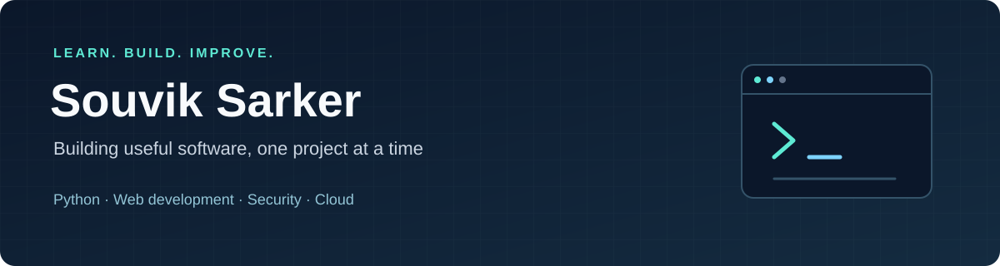

  

<h1 align="center">Hi, I'm Souvik 👋</h1>

  <strong>Learning by building</strong> 
  Building practical projects and learning how to make software useful, secure and reliable.

  <a href="https://www.linkedin.com/in/souviksarker">LinkedIn</a> ·
  <a href="https://souviks.com">Website</a> ·
  <a href="mailto:souvik.govt@gmail.com">Email</a> ·
  <a href="./learning-log.md">Learning log</a>

## A little about me

I'm Souvik Sarker, from Bangladesh and based in Adelaide, Australia. I enjoy building useful software and learning through hands-on projects.

I'm interested in Python, web development, cybersecurity and cloud systems. This profile brings together my public projects, experiments and learning notes as I build a regular coding habit.

## Selected projects

| Project | What you'll find | Stage |
| :--- | :--- | :--- |
| [**Study Planner**](https://github.com/SouviksHub/study-planner) | A React-based study planner with class schedules, tasks, notes and a Pomodoro timer. | Personal project |
| [**MailSentry**](https://github.com/SouviksHub/MailSentry) | An email security project with a React interface and a planned Python/FastAPI backend. | Early prototype |
| [**Dotfiles**](https://github.com/SouviksHub/dotfiles) | My Vim, tmux and shell configuration for a repeatable development setup. | Personal toolkit |
| [**Java Weather Service**](https://github.com/SouviksHub/Assignment2DS) | A socket-based aggregation server and clients for exchanging weather data. | Earlier coursework |

## What I'm learning

| Focus | Next steps |
| :--- | :--- |
| **Python** | Small programs, clear functions, file handling and useful tests |
| **Linux and Git** | Command-line practice, branches and clear commit messages |
| **Web development** | Improve existing projects and document how to run them |
| **Cloud and reliability** | Build Linux and Docker foundations, then explore Kubernetes |
| **Cybersecurity and AI** | Explore practical security problems and evaluate ideas carefully |

## How I learn

My current learning areas include programming, data visualisation and cybersecurity ethics. I use GitHub to organise my work and develop projects I can explain, run and improve.

Public repositories contain selected projects, experiments and personal learning notes.

## Building a regular coding habit

**Learn one thing. Build something small. Check it works. Write down what changed.**

My regular practice starts on **22 October 2026**. I'll record completed work in my [learning log](./learning-log.md), with links to the code and a short note about what I learned.

For new projects, I use a [README template](./templates/PROJECT-README.md) to explain the problem, setup, examples, checks and next steps.

---

  Open to learning with others and sharing useful ideas. 
  <a href="https://github.com/SouviksHub?tab=repositories">Browse my repositories</a>

